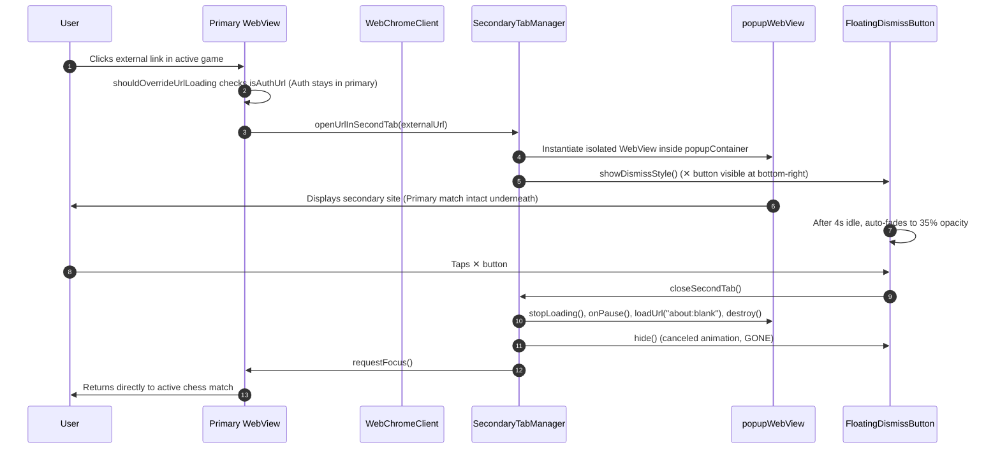
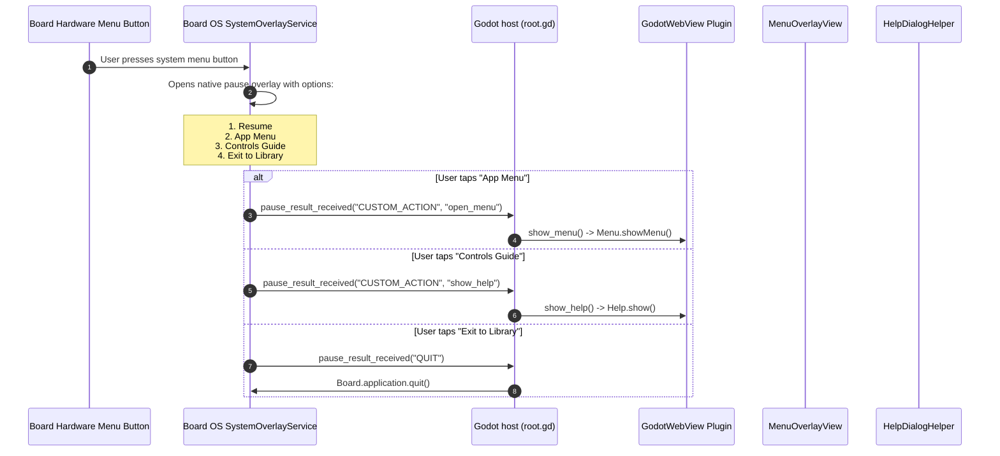
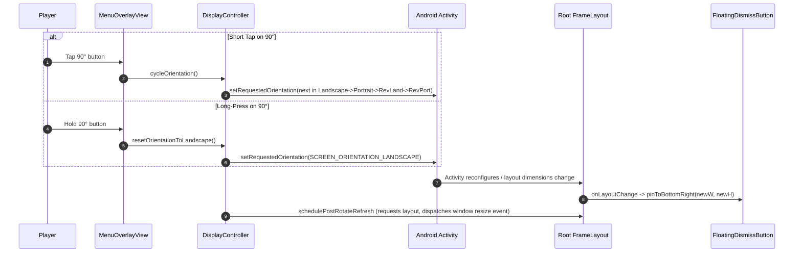
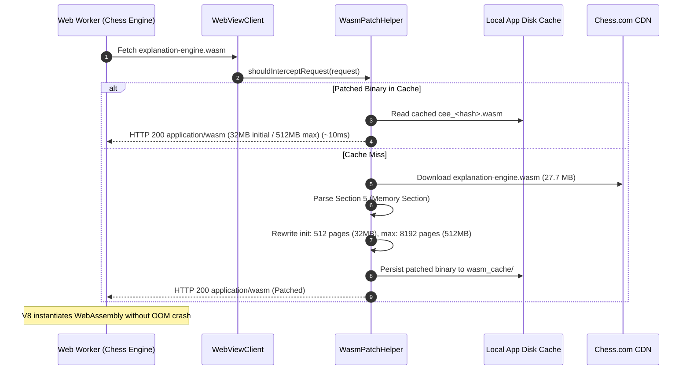

# ChessBoard — System Architecture & Component Specification

This document provides a comprehensive technical reference for the system architecture, component breakdown, view hierarchy, event lifecycles, and design decisions of **ChessBoard** (`com.lastersoft.chessboard`).

---

## 1. High-Level System Architecture

```mermaid
flowchart TD
    subgraph BoardHardware ["Board Digital Tabletop Device"]
        TouchScreen["Large Format Touchscreen Display"]
        BoardOS["Board Android OS (co.harrishill.board.*)"]
        BoardOverlay["SystemOverlayService & Pause Overlay"]
        BoardSession["SessionManagerBridge"]
    end

    subgraph GodotHost ["Godot 4.7 Host Application (chess-4-board)"]
        RootScene["chess.tscn / root.gd"]
        SplashTimer["3-Second Custom Splash Screen"]
        NativeLibs["libboard.so / libnativeBoardSDK.so"]
        GodotSignals["Signal: quit_app_requested"]
    end

    subgraph NativePlugin ["Native Android Plugin (GodotWebView AAR)"]
        Coordinator["GodotWebView.java\n(Facade & Coordinator)"]
        
        subgraph Subsystems ["Modular Subsystems"]
            Bridge["BoardBridge.java\n(Board OS Reflection)"]
            Secondary["SecondaryTabManager.java\n(Popup Tab & Multi-Window)"]
            DismissBtn["FloatingDismissButton.java\n(Draggable ✕ with Auto-Fade)"]
            MenuCard["MenuOverlayView.java\n(2x Scaled Tabletop Menu)"]
            UA["UserAgentManager.java\n(Desktop/Mobile UA & Prefs)"]
            Display["DisplayController.java\n(Zoom & 4-Way 90° Rotation)"]
            Catalog["AppCatalog.java\n(Sites & Categorized Apps)"]
            TouchHelper["ChessTouchHelper.java\n(Sidebar Touch & Flyout Bridge)"]
            WasmPatch["WasmPatchHelper.java\n(Wasm Memory & OOM Interceptor)"]
            HelpDialog["HelpDialogHelper.java\n(2x Modal Controls Guide)"]
        end
    end

    subgraph ChromiumLayer ["Chromium WebView Engine"]
        PrimaryWeb["Primary WebView\n(Active Chess Match)"]
        PopupWeb["Secondary popupWebView\n(External Links / Popups)"]
    end

    TouchScreen --> BoardOS
    BoardOS --> BoardOverlay
    BoardOverlay <--> Bridge
    BoardSession <--> Bridge
    
    RootScene --> Coordinator
    Coordinator --> Bridge
    Coordinator --> Secondary
    Coordinator --> DismissBtn
    Coordinator --> MenuCard
    Coordinator --> UA
    Coordinator --> Display
    Coordinator --> Catalog
    Coordinator --> TouchHelper
    Coordinator --> WasmPatch
    Coordinator --> HelpDialog

    Secondary --> PopupWeb
    Coordinator --> PrimaryWeb
    TouchHelper -. Injects Bridge .-> PrimaryWeb
    TouchHelper -. Injects Bridge .-> PopupWeb
    WasmPatch -. Intercepts Wasm .-> PrimaryWeb
    WasmPatch -. Intercepts Wasm .-> PopupWeb
    Coordinator -. Emits .-> GodotSignals
    Bridge -. Terminates .-> BoardSession
```



---

## 2. Core Architectural Subsystems

The native plugin lives in package `com.lastersoft.godotwebview` and is modularized into 11 cohesive classes:

| Class | Responsibility | Key Collaborators / Dependencies |
|---|---|---|
| [`GodotWebView.java`](file:///Users/adamlaster/Development/BoardGames/Chess4Board/godot-webview/GodotWebView/GodotWebView/src/main/java/com/lastersoft/godotwebview/GodotWebView.java) | **Plugin Facade & Coordinator:** Extends `GodotPlugin`, exposes `@UsedByGodot` entry points (`open`, `close`, `show_menu`, `show_help`, `prepareBoardTouchPassthrough`), binds primary `WebViewClient` and `WebChromeClient`, and manages top-level view lifecycle. | Coordinates all component managers; interacts directly with Godot Engine. |
| [`BoardBridge.java`](file:///Users/adamlaster/Development/BoardGames/Chess4Board/godot-webview/GodotWebView/GodotWebView/src/main/java/com/lastersoft/godotwebview/BoardBridge.java) | **Board OS Hardware Bridge:** Reflection-based integration with `co.harrishill.board.*`. Sets `BoardNativePlugin.setSwallowSystemTouches(false)` to preserve standard touch input, hooks `PauseResultCallbackImpl` to intercept system pause menu actions, registers `"App Menu"` and `"Controls Guide"` action context fallback, and invokes `SessionManagerBridge.terminateApplication()` on exit. | `co.harrishill.board.core.BoardNativePlugin`, `co.harrishill.board.pausescreen.PauseResultCallbackImpl`, `co.harrishill.board.session.SessionManagerBridge` |
| [`SecondaryTabManager.java`](file:///Users/adamlaster/Development/BoardGames/Chess4Board/godot-webview/GodotWebView/GodotWebView/src/main/java/com/lastersoft/godotwebview/SecondaryTabManager.java) | **Multi-Window Popup Subsystem:** Manages the isolated popup `WebView` container (`popupContainer`), progress bar, and WebChromeClient / WebViewClient event hooks. Strips `X-Requested-With` via `androidx.webkit`, catches `<a target="_blank">`, `window.open()`, and outbound links clicked during a chess game without reloading or disconnecting the primary game underneath, and reroutes any stray OAuth popups back to the primary WebView via `onAuthRedirect`. | `FloatingDismissButton`, `MenuOverlayView`, `UserAgentManager`, `DisplayController`, `ChessTouchHelper`, `WasmPatchHelper`, `androidx.webkit` |
| [`FloatingDismissButton.java`](file:///Users/adamlaster/Development/BoardGames/Chess4Board/godot-webview/GodotWebView/GodotWebView/src/main/java/com/lastersoft/godotwebview/FloatingDismissButton.java) | **Ergonomic Floating Controls:** 58dp circular draggable action button (`✕`). Uses `ViewConfiguration.getScaledTouchSlop()` to differentiate taps from drags, clamps movement within container margins, implements a 4-second idle auto-fade (`35%` opacity) to prevent obscuring game content, and triggers secondary tab teardown on tap. | Android `MotionEvent`, `FrameLayout` |
| [`MenuOverlayView.java`](file:///Users/adamlaster/Development/BoardGames/Chess4Board/godot-webview/GodotWebView/GodotWebView/src/main/java/com/lastersoft/godotwebview/MenuOverlayView.java) | **2x Tabletop Menu Interface:** 2x scaled centered card (`menuCard`) styled in dark acrylic (`#F01A1A1A`) with touch-slop tap dismiss scrim (`scrimView`). Consumes all touches on the card, filtering out drag/swipe gestures on the scrim (`ViewConfiguration.getScaledTouchSlop()`) so the menu dismisses strictly via explicit tap outside or the close button. Houses quick chess buttons, collapsible extra apps accordion, and bottom control row (`[ Back ] [ Zoom+ ] [ Zoom- ] [ Refresh ] [ Desktop ] [ Margin ◧ ] [ 90° ] [ Close ✕ ]` powered by `ControlIconDrawable` Material vector icons). | `AppCatalog`, `UserAgentManager`, `MenuActionListener` |
| [`HelpDialogHelper.java`](file:///Users/adamlaster/Development/BoardGames/Chess4Board/godot-webview/GodotWebView/GodotWebView/src/main/java/com/lastersoft/godotwebview/HelpDialogHelper.java) | **2x Modal Controls & Gestures Guide:** Displays a 2x tabletop-scaled dark acrylic modal dialog (`AlertDialog`) triggered from the Board OS system pause menu detailing all 4 live control systems: Chess Gestures & Touch Ergonomics, Menu Controls Row, Secondary Tabs, and Board OS System Menu. Features a top-right circular `✕` close button, sleek centered pill button, and mutual auto-dismissal when the links menu opens. | Android `AlertDialog`, `ScrollView`, `RelativeLayout`, `LinearLayout` |
| [`UserAgentManager.java`](file:///Users/adamlaster/Development/BoardGames/Chess4Board/godot-webview/GodotWebView/GodotWebView/src/main/java/com/lastersoft/godotwebview/UserAgentManager.java) | **User-Agent Management & Persistence:** Manages Desktop (`🖥`) vs. Mobile (`📱`) modes with per-site persistent storage in `SharedPreferences` (`chessboard_prefs` / `site_ua_<host>`). Strips `X-Requested-With` via `androidx.webkit`, derives desktop User-Agent dynamically from native Chromium engine, dynamically normalizes auth URLs (`isAuthUrl`) to clean native mobile User-Agent for Google/Cloudflare compliance, rewrites YouTube query parameters (`app=desktop` / `app=mobile`), and styles menu toggle buttons. | `SharedPreferences`, `WebSettings`, `AlertDialog`, `androidx.webkit` |
| [`DisplayController.java`](file:///Users/adamlaster/Development/BoardGames/Chess4Board/godot-webview/GodotWebView/GodotWebView/src/main/java/com/lastersoft/godotwebview/DisplayController.java) | **Zoom Stepping & Tabletop Orientation:** Implements 5-level step zoom (`75%`, `100%`, `125%`, `150%`, `200%`) applied via `setTextZoom` + CSS `document.documentElement.style.zoom`. Cycles clockwise through 4 tabletop orientations (`Landscape` → `Portrait` → `Reverse Landscape` → `Reverse Portrait`) with long-press reset to Landscape, scheduling layout invalidation and resize events. | Android `ActivityInfo`, `Configuration`, `WebView` |
| [`ChessTouchHelper.java`](file:///Users/adamlaster/Development/BoardGames/Chess4Board/godot-webview/GodotWebView/GodotWebView/src/main/java/com/lastersoft/godotwebview/ChessTouchHelper.java) | **Chess Ergonomics & Gesture Bridge:** Injects two client-side bridges: (1) **Sidebar Navigation Bridge:** Intercepts desktop hover/touch mismatch on Chess.com, eliminating premature redirects to `/play`, expanding flyout submenus via synthetic `mouseenter`, and blocking premature unmounts on finger lift. (2) **Single-Finger Double-Tap Right-Click Gesture Bridge:** Translates double-taps on `<wc-chess-board>` / `<cg-board>` into synthetic right-click events (`button: 2`, `buttons: 2`, `which: 3`), enabling tactical arrow drawing (double-tap & drag) and square highlighting (double-tap in place) on touchscreen displays while suppressing browser pinch-zoom and keeping single-finger piece movement 100% native. | Android `WebView` evaluation, Chess.com & Lichess DOM architecture |
| [`WasmPatchHelper.java`](file:///Users/adamlaster/Development/BoardGames/Chess4Board/godot-webview/GodotWebView/GodotWebView/src/main/java/com/lastersoft/godotwebview/WasmPatchHelper.java) | **WebAssembly Memory Interceptor & Patching:** Intercepts network requests in `shouldInterceptRequest` for WebAssembly binaries compiled with oversized memory allocations (specifically Chess.com's `explanation-engine.wasm` used by Komodo/CEE bots and Coach). Rewrites binary Section 5 (Memory Section) on-the-fly to reduce initial memory from 386 MB (6,176 pages) to 32 MB (512 pages) and max memory from 2 GB to 512 MB. Caches patched binaries in app cache (`wasm_cache/`) for instant sub-10ms loads, eliminating Android V8 virtual memory exhaustion (`WebAssembly.instantiate(): Out of memory`). | Android `WebViewClient.shouldInterceptRequest`, WebAssembly binary format |
| [`AppCatalog.java`](file:///Users/adamlaster/Development/BoardGames/Chess4Board/godot-webview/GodotWebView/GodotWebView/src/main/java/com/lastersoft/godotwebview/AppCatalog.java) | **Application & Category Registry:** Immutable registry of primary chess sites (`MAIN_SITES`) and categorized extra applications (`EXTRA_CATEGORIES` across Games, Video, and Web). Ready for future runtime persistence. | Data models `SiteEntry` and `CategoryEntry` |

---

## 3. View Hierarchy & Z-Ordering

All views are hosted within a single root `FrameLayout` added to the Godot `Activity`. The Z-order layering guarantees that controls, popups, and scrims stack correctly without intercepting underlying touch events when hidden:

```text
Root FrameLayout (Activity Root)
 │
 ├── [Layer 0] Primary WebView (Match Parent)
 │     └── Hardware-accelerated Chromium rendering surface (active game)
 │
 ├── [Layer 1] Primary ProgressBar (Top, 4dp height, #43A047 green)
 │     └── Visible only during page loading (WebChromeClient.onProgressChanged)
 │
 ├── [Layer 2] Secondary Tab Container (FrameLayout, popupContainer)
 │     │   (Injected below Scrim & Menu so menus can open on top of popups)
 │     ├── Secondary popupWebView (Match Parent)
 │     ├── Secondary popupProgressBar (Top, 4dp)
 │     └── popupCustomView (Fullscreen video playback surface, if active)
 │
 ├── [Layer 3] Fullscreen Backdrop Scrim (View, scrimView)
 │     └── Translucent 30% black (#4D000000), dismisses menu on outside click
 │
 ├── [Layer 4] Centered Menu Card (LinearLayout, menuCard)
 │     └── 2x scaled (365dp * 2.0 wide), rounded corners (18dp), elevation (12dp)
 │
 ├── [Layer 5] Floating Dismiss Button (Button, floatingButton)
 │     └── 58dp circular button ("✕" with red border when secondary tab is open)
 │
 └── [Layer 6] Primary customView (FrameLayout, if active)
       └── Fullscreen video surface for primary WebView (brings scrim/card/button to front)
```

---

## 4. Key Event Sequences

### 4.1 Secondary Tab Spawning & Dismissal Flow
Protects the active chess game from navigation changes when an external or new-window link is clicked:



---

### 4.2 Board OS System Pause Menu Integration
Hooks into the Board hardware/OS menu overlay via dynamic proxy reflection:



---

### 4.3 4-Way Tabletop Orientation Cycling & Re-Pinning
Enables tabletop players seated at any side of the physical table to rotate the viewport:



---

### 4.4 WebAssembly Memory Interception & On-The-Fly Binary Patching
Eliminates out-of-memory crashes on Chess.com when loading Komodo/CEE bot engines and Coach:



---

## 5. Architectural Design Decisions & Trade-Offs

### 5.1 Reflection for Board SDK Integration
* **Decision:** All interactions with `co.harrishill.board.*` are executed via Java reflection in [`BoardBridge.java`](file:///Users/adamlaster/Development/BoardGames/Chess4Board/godot-webview/GodotWebView/GodotWebView/src/main/java/com/lastersoft/godotwebview/BoardBridge.java) rather than compile-time Gradle dependencies.
* **Rationale:** The Board SDK `.aar` files (`boardNativePlugin-release.aar`, `sessionManager-release.aar`, `systemOverlay-release.aar`) are bundled exclusively within the Godot export template (`chess-4-board/addons/board_sdk/`). Linking them directly into the `GodotWebView` library would create duplicate class collisions at APK packaging time and prevent the AAR from compiling independently. Reflection maintains loose coupling and zero-overhead execution.

### 5.2 Out-of-Tree APK Export Pipeline
* **Decision:** The compiled binary `ChessBoard.apk` is exported by default directly to the out-of-tree sibling directory `../output/ChessBoard.apk` (configurable via `OUTPUT_DIR` in `.env` / `.env.local`).
* **Rationale:** Mandated by workspace hygiene rules ([`AGENTS.md`](file:///Users/adamlaster/Development/BoardGames/Chess4Board/AGENTS.md)). Large 90+ MB APK binaries are kept entirely outside the git workspace tree to prevent repository bloat, while still remaining easily deployable via `board-connect`.

### 5.3 Hardware Touch Passthrough over Raw Input
* **Decision:** Touch input is captured directly by Android's native view hierarchy via Chromium's touch pipeline after disabling Board's touch swallower (`BoardNativePlugin.setSwallowSystemTouches(false)`).
* **Rationale:** Early iterations suffered from swallowed touches or laggy simulated gestures. Disabling touch swallowing allows the Android Chromium `WebView` to receive 100% of raw multi-touch events directly from the Linux input subsystem, enabling buttery-smooth piece dragging, board zooming, and web navigation.

### 5.4 Dual-Layer WebView for Multi-Window Isolation
* **Decision:** Secondary tabs instantiate a brand-new `WebView` inside `popupContainer` rather than navigating the main `WebView`.
* **Rationale:** Chess platforms (such as Chess.com and Lichess) maintain active WebSockets and Web Worker game trees. Navigating away terminates the connection and forfeits the game. An isolated overlay WebView guarantees that game state, clock synchronization, and audio remain undisturbed while checking external links.

### 5.5 Network-Layer WebAssembly Interception vs. JS Monkey-Patching
* **Decision:** Intercept and rewrite WebAssembly binary headers at the native Android network layer via `WebViewClient.shouldInterceptRequest()` rather than JavaScript monkey-patching `window.WebAssembly`.
* **Rationale:** Chess.com executes its Chess Explanation Engine (CEE / Komodo) inside a dedicated `Worker` spawned from an external blob/script. JavaScript injected into the main page frame cannot override or monkey-patch `self.WebAssembly` inside web workers. Intercepting the HTTP request allows the native layer to deliver a patched binary with safe initial memory limits (32 MB instead of 386 MB) to both main-frame and worker threads alike.

---

## 6. Related Documentation

* **[`README.md`](./README.md)** — Project overview, menu controls quick reference, and complete catalog of primary chess suites and extra web applications.
* **[`BUILD_SEQUENCE.md`](./BUILD_SEQUENCE.md)** — Step-by-step breakdown of the Gradle, Godot CLI headless export, and `board-connect` deployment pipeline.
* **[`PROJECT_HISTORY.md`](./PROJECT_HISTORY.md)** — Complete chronological engineering log, architectural decisions log, and future roadmap.
* **[`AGENTS.md`](./AGENTS.md)** — Workspace conventions, canonical root file rules, and build/output hygiene.


