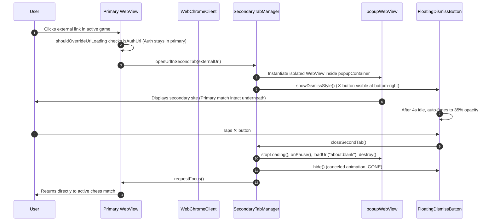
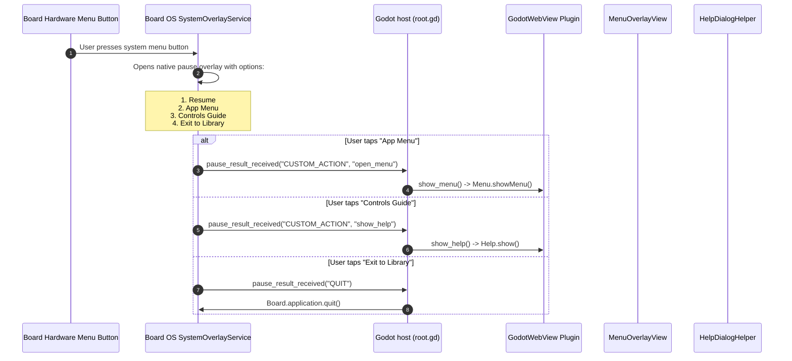
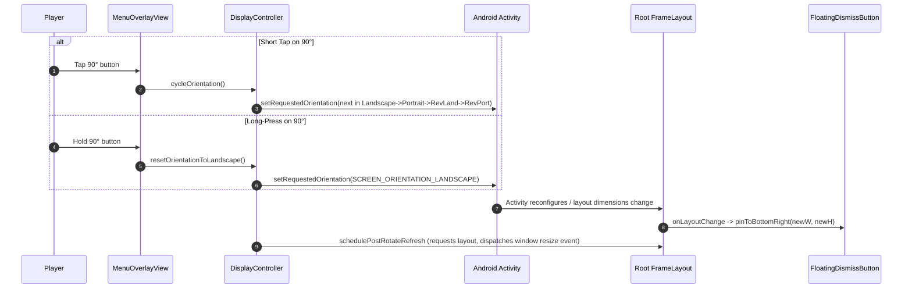
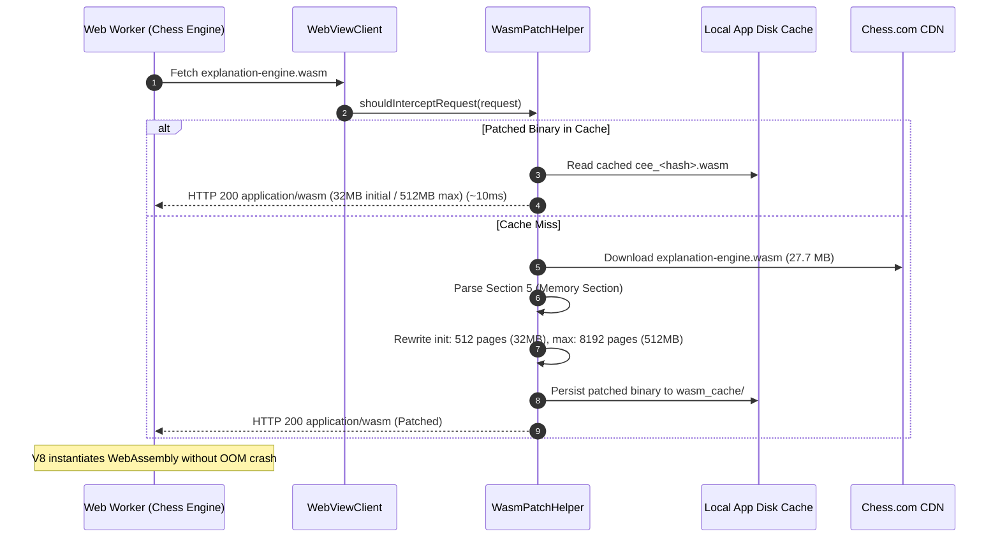
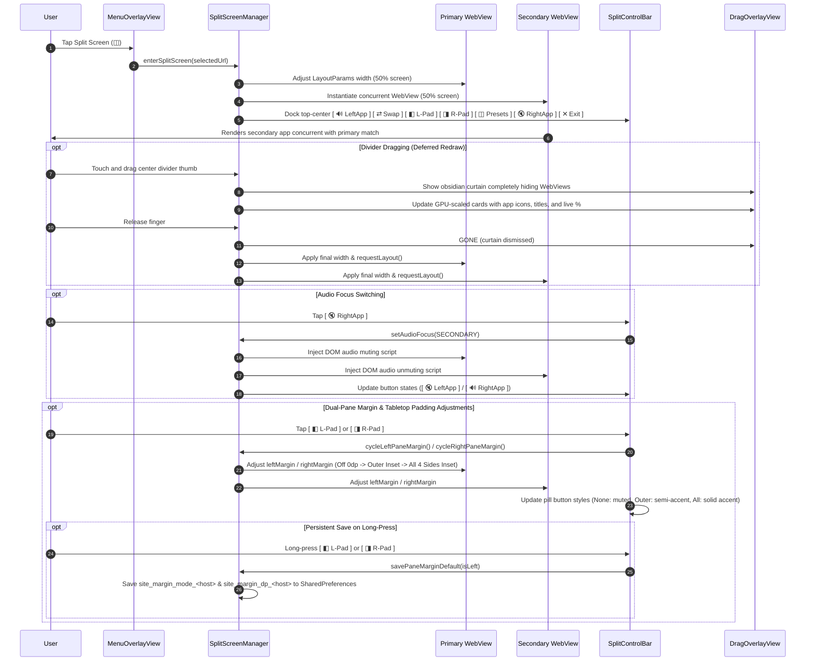

# ChessBoard — System Architecture & Component Specification

This document provides a comprehensive technical reference for the system architecture, component breakdown, view hierarchy, event lifecycles, and design decisions of **ChessBoard** (`com.lastersoft.chessboard`).

---

## 1. High-Level System Architecture

```mermaid
flowchart TD
    subgraph BoardHardware ["Board Digital Tabletop Device"]
        TouchScreen["Large Format Touchscreen Display"]
        BoardOS["Board Android OS (co.harrishill.board.*)"]
        BoardOverlay["SystemOverlayService & Pause Overlay"]
        BoardSession["SessionManagerBridge"]
    end

    subgraph GodotHost ["Godot 4.7 Host Application (chessboard)"]
        RootScene["chess.tscn / root.gd"]
        SplashTimer["3-Second Custom Splash Screen"]
        NativeLibs["libboard.so / libnativeBoardSDK.so"]
        GodotSignals["Signal: quit_app_requested"]
    end

    subgraph NativePlugin ["Native Android Plugin (GodotWebView AAR)"]
        Coordinator["GodotWebView.java\n(Facade & Coordinator)"]
        
        subgraph Subsystems ["Modular Subsystems"]
            BezelLayout["BezelGestureFrameLayout.java\n(Bezel Edge Gesture Detection)"]
            SplitScreen["SplitScreenManager.java\n(Dual App & Top Controls)"]
            Bridge["BoardBridge.java\n(Board OS Reflection)"]
            Secondary["SecondaryTabManager.java\n(Popup Tab & Multi-Window)"]
            DismissBtn["FloatingDismissButton.java\n(Draggable ✕ with Auto-Fade)"]
            MenuCard["MenuOverlayView.java\n(2x Scaled Tabletop Menu)"]
            ThemeMgr["ThemeManager.java\n(Michigan & Classic Themes)"]
            ThemePicker["ThemePickerDialogHelper.java\n(Modal Theme Picker)"]
            UA["UserAgentManager.java\n(Desktop/Mobile UA & Prefs)"]
            SiteSettings["SiteSettingsDialogHelper.java\n(Per-Site UA & Margin)"]
            Display["DisplayController.java\n(Zoom & 4-Way 90° Rotation)"]
            Catalog["AppCatalog.java\n(Sites & Categorized Apps)"]
            TouchHelper["ChessTouchHelper.java\n(Sidebar Touch & Flyout Bridge)"]
            WasmPatch["WasmPatchHelper.java\n(Wasm Memory & OOM Interceptor)"]
            HelpDialog["HelpDialogHelper.java\n(2x Modal Controls Guide)"]
        end
    end

    subgraph ChromiumLayer ["Chromium WebView Engine"]
        PrimaryWeb["Primary WebView\n(Active Chess Match)"]
        PopupWeb["Secondary popupWebView\n(External Links / Popups)"]
    end

    TouchScreen --> BoardOS
    BoardOS --> BoardOverlay
    BoardOverlay <--> Bridge
    BoardSession <--> Bridge
    
    RootScene --> Coordinator
    Coordinator --> BezelLayout
    Coordinator --> Bridge
    Coordinator --> SplitScreen
    Coordinator --> Secondary
    Coordinator --> DismissBtn
    Coordinator --> MenuCard
    Coordinator --> ThemeMgr
    Coordinator --> UA
    Coordinator --> SiteSettings
    Coordinator --> Display
    Coordinator --> Catalog
    Coordinator --> TouchHelper
    Coordinator --> WasmPatch
    Coordinator --> HelpDialog
    MenuCard --> ThemePicker
    ThemeMgr -. Applies Theme .-> MenuCard
    ThemeMgr -. Applies Theme .-> SplitScreen

    Secondary --> PopupWeb
    Coordinator --> PrimaryWeb
    TouchHelper -. Injects Bridge .-> PrimaryWeb
    TouchHelper -. Injects Bridge .-> PopupWeb
    WasmPatch -. Intercepts Wasm .-> PrimaryWeb
    WasmPatch -. Intercepts Wasm .-> PopupWeb
    Coordinator -. Emits .-> GodotSignals
    Bridge -. Terminates .-> BoardSession
```



---

## 2. Core Architectural Subsystems

The native plugin lives in package `com.lastersoft.godotwebview` and is modularized into 16 cohesive classes:

| Class | Responsibility | Key Collaborators / Dependencies |
|---|---|---|
| [`GodotWebView.java`](file:///Users/adamlaster/Development/BoardGames/Chess4Board/godot-webview/GodotWebView/GodotWebView/src/main/java/com/lastersoft/godotwebview/GodotWebView.java) | **Plugin Facade & Coordinator:** Extends `GodotPlugin`, exposes `@UsedByGodot` entry points (`open`, `close`, `show_launcher`, `show_browser_controls`, `show_help`, `prepareBoardTouchPassthrough`), binds primary `WebViewClient` and `WebChromeClient`, and manages top-level view lifecycle. | Coordinates all component managers; interacts directly with Godot Engine. |
| [`BezelGestureFrameLayout.java`](file:///Users/adamlaster/Development/BoardGames/Chess4Board/godot-webview/GodotWebView/GodotWebView/src/main/java/com/lastersoft/godotwebview/BezelGestureFrameLayout.java) | **Root Bezel Gesture Container:** Specialized `FrameLayout` subclass serving as the root layout container. Intercepts bezel-initiated edge swipe gestures (top bezel downward swipe -> Fullscreen Launcher, right bezel leftward swipe below cutout -> Browser Controls rail). Overrides `requestDisallowInterceptTouchEvent` during gesture tracking, enforces strict directional dominance, aborts on multi-touch pointers, and avoids the Board OS hardware button corner cutout. Actively consumes `ACTION_DOWN` and evaluates edge swipes directly in `onTouchEvent` when touches land in empty split-screen margin gutters, guaranteeing reliable bezel gesture triggering across all margin modes. | `GodotWebView`, Android `MotionEvent`, `ViewConfiguration` |
| [`SplitScreenManager.java`](file:///Users/adamlaster/Development/BoardGames/Chess4Board/godot-webview/GodotWebView/GodotWebView/src/main/java/com/lastersoft/godotwebview/SplitScreenManager.java) | **Split-Screen Dual-App Tabletop Subsystem:** Manages concurrent, hardware-accelerated dual WebViews (Primary & Secondary), draggable center divider with snap presets (`50/50`, `70/30`, `30/70`), DOM media audio focus bridge with A/B switching and long-press mute-all, 180° head-to-head inversion, secondary pane hot-swap & history navigation, media play/pause quick control, themed obsidian drag overlay with live GPU-scaled cards, independent dual-pane margin & padding adjustments (`[ ◧ L-Pad ]` / `[ ◨ R-Pad ]`) with per-site persistence, automatic responsive split presets (70/30 for ChessKid to enforce Desktop Landscape layout), and top-docked unified scrollable split controls bar visible only when Browser Controls are open. | `GodotWebView`, `MenuOverlayView`, `ThemeManager`, `UserAgentManager`, `SiteSettingsDialogHelper`, `AppCatalog`, `ChessTouchHelper`, `WasmPatchHelper` |
| [`ThemeManager.java`](file:///Users/adamlaster/Development/BoardGames/Chess4Board/godot-webview/GodotWebView/GodotWebView/src/main/java/com/lastersoft/godotwebview/ThemeManager.java) | **Theme System & Palette Tokens:** Manages dynamic UI theme presets (University of Michigan, Detroit Pistons, Detroit Lions, Detroit Tigers, Utica Unicorns, Tournament Walnut, Club Emerald, Midnight Carbon, and Classic Slate), palette color tokens (cutout background, header text, card surfaces, borders, dividers, drag overlays, and active audio accents), and persistent theme configuration in `SharedPreferences` (`chessboard_prefs` / `app_theme_id`). | `SharedPreferences`, `MenuOverlayView`, `SplitScreenManager` |
| [`ThemePickerDialogHelper.java`](file:///Users/adamlaster/Development/BoardGames/Chess4Board/godot-webview/GodotWebView/GodotWebView/src/main/java/com/lastersoft/godotwebview/ThemePickerDialogHelper.java) | **Tabletop Theme Picker Modal:** 2x tabletop-scaled acrylic modal dialog allowing the user to select between 9 team, classic, and boardroom themes with live preview swatches, active selection badge, and immediate dynamic re-theming without reloading pages. | `ThemeManager`, `AlertDialog`, Android UI |
| [`BoardBridge.java`](file:///Users/adamlaster/Development/BoardGames/Chess4Board/godot-webview/GodotWebView/GodotWebView/src/main/java/com/lastersoft/godotwebview/BoardBridge.java) | **Board OS Hardware Bridge:** Reflection-based integration with `co.harrishill.board.*`. Sets `BoardNativePlugin.setSwallowSystemTouches(false)` to preserve standard touch input, hooks `PauseResultCallbackImpl` to intercept system pause menu actions, registers `"Launcher"` and `"Browser Controls"` action context fallback, and invokes `SessionManagerBridge.terminateApplication()` on exit. | `co.harrishill.board.core.BoardNativePlugin`, `co.harrishill.board.pausescreen.PauseResultCallbackImpl`, `co.harrishill.board.session.SessionManagerBridge` |
| [`SecondaryTabManager.java`](file:///Users/adamlaster/Development/BoardGames/Chess4Board/godot-webview/GodotWebView/GodotWebView/src/main/java/com/lastersoft/godotwebview/SecondaryTabManager.java) | **Multi-Window Popup Subsystem:** Manages the isolated popup `WebView` container (`popupContainer`), progress bar, and WebChromeClient / WebViewClient event hooks. Strips `X-Requested-With` via `androidx.webkit`, catches `<a target="_blank">`, `window.open()`, and outbound links clicked during a chess game without reloading or disconnecting the primary game underneath, and reroutes any stray OAuth popups back to the primary WebView via `onAuthRedirect`. | `FloatingDismissButton`, `MenuOverlayView`, `UserAgentManager`, `DisplayController`, `ChessTouchHelper`, `WasmPatchHelper`, `androidx.webkit` |
| [`FloatingDismissButton.java`](file:///Users/adamlaster/Development/BoardGames/Chess4Board/godot-webview/GodotWebView/GodotWebView/src/main/java/com/lastersoft/godotwebview/FloatingDismissButton.java) | **Ergonomic Floating Controls:** 58dp circular draggable action button (`✕`). Uses `ViewConfiguration.getScaledTouchSlop()` to differentiate taps from drags, clamps movement within container margins, implements a 4-second idle auto-fade (`35%` opacity) to prevent obscuring game content, and triggers secondary tab teardown on tap. | Android `MotionEvent`, `FrameLayout` |
| [`MenuOverlayView.java`](file:///Users/adamlaster/Development/BoardGames/Chess4Board/godot-webview/GodotWebView/GodotWebView/src/main/java/com/lastersoft/godotwebview/MenuOverlayView.java) | **Decoupled Launcher & Browser Controls:** Manages two decoupled views: (1) **Fullscreen Launcher:** 5-row categorized application launcher (Primary Chess, Tabletop Duos, Games, Watch, Web) hosted in a custom `FrameLayout` (`launcherRoot`) with `CutoutBackgroundDrawable` notch around the Board OS menu button. Implements deadspace tap dismissal with near-miss protection (36px card buffer, 18px header buffer) so taps between cards never close the launcher, while taps in empty deadspace cleanly dismiss it. Positions the red circular close button (`✕`) below the cutout matching Browser Controls coordinates to the exact pixel. Supports dual-action long-press on any card: holding still or releasing displays the Site Settings dialog, while dragging vertically right away picks up and reorders the entire category row live with smooth sibling slot displacement. Also supports direct row dragging from category headers (`⠿`). (2) **Browser Controls Rail:** Slim vertical toolbar overlay docked directly over the live browser below the Board OS button (`topMargin = cutoutSize + 24dp`), keeping controls (Close, Back, Zoom In/Out, Refresh, Desktop UA, 3-state Margin toggle, Rotate 90°, and Launcher switch) accessible during live page interaction. Rail remains persistent across screen rotation and live touches. | `AppCatalog`, `UserAgentManager`, `SiteSettingsDialogHelper`, `MenuActionListener` |
| [`SiteSettingsDialogHelper.java`](file:///Users/adamlaster/Development/BoardGames/Chess4Board/godot-webview/GodotWebView/GodotWebView/src/main/java/com/lastersoft/godotwebview/SiteSettingsDialogHelper.java) | **Per-Site Settings Subsystem:** Tabletop modal dialog triggered by 500ms long-press on any Launcher card. Allows configuring per-site User-Agent mode (Desktop vs Mobile) and custom Margin values with 3 preset modes (None 0dp, Right 106dp Gutter, or All 4 Sides 106dp Inset, plus 0..200dp fine stepper), with live update on active session and persistent storage in `SharedPreferences`. | `UserAgentManager`, `AppCatalog`, `GodotWebView` |
| [`HelpDialogHelper.java`](file:///Users/adamlaster/Development/BoardGames/Chess4Board/godot-webview/GodotWebView/GodotWebView/src/main/java/com/lastersoft/godotwebview/HelpDialogHelper.java) | **2x Modal Controls & Gestures Guide:** Displays a 2x tabletop-scaled dark acrylic modal dialog (`AlertDialog`) triggered from the Launcher header detailing all 4 live control systems: Chess Gestures & Touch Ergonomics, Menu Controls Row, Secondary Tabs, and Board OS System Menu. Features a sleek centered bottom pill button (`Done`) and mutual auto-dismissal when the links menu opens. | Android `AlertDialog`, `ScrollView`, `RelativeLayout`, `LinearLayout` |
| [`UserAgentManager.java`](file:///Users/adamlaster/Development/BoardGames/Chess4Board/godot-webview/GodotWebView/GodotWebView/src/main/java/com/lastersoft/godotwebview/UserAgentManager.java) | **User-Agent Management & Persistence:** Manages Desktop (`🖥`) vs. Mobile (`📱`) modes with per-site persistent storage in `SharedPreferences` (`chessboard_prefs` / `site_ua_<host>`). Strips `X-Requested-With` via `androidx.webkit`, derives desktop User-Agent dynamically from native Chromium engine, dynamically normalizes auth URLs (`isAuthUrl`) to clean native mobile User-Agent for Google/Cloudflare compliance, rewrites YouTube query parameters (`app=desktop` / `app=mobile`), and styles menu toggle buttons. | `SharedPreferences`, `WebSettings`, `AlertDialog`, `androidx.webkit` |
| [`DisplayController.java`](file:///Users/adamlaster/Development/BoardGames/Chess4Board/godot-webview/GodotWebView/GodotWebView/src/main/java/com/lastersoft/godotwebview/DisplayController.java) | **Zoom Stepping & Tabletop Orientation:** Implements 5-level step zoom (`75%`, `100%`, `125%`, `150%`, `200%`) applied via `setTextZoom` + CSS `document.documentElement.style.zoom`. Cycles clockwise through 4 tabletop orientations (`Landscape` → `Portrait` → `Reverse Landscape` → `Reverse Portrait`) with long-press reset to Landscape, scheduling layout invalidation and resize events. | Android `ActivityInfo`, `Configuration`, `WebView` |
| [`ChessTouchHelper.java`](file:///Users/adamlaster/Development/BoardGames/Chess4Board/godot-webview/GodotWebView/GodotWebView/src/main/java/com/lastersoft/godotwebview/ChessTouchHelper.java) | **Chess Ergonomics & Gesture Bridge:** Injects two client-side bridges: (1) **Sidebar Navigation Bridge:** Intercepts desktop hover/touch mismatch on Chess.com, eliminating premature redirects to `/play`, expanding flyout submenus via synthetic `mouseenter`, and blocking premature unmounts on finger lift. (2) **Single-Finger Double-Tap Right-Click Gesture Bridge:** Translates double-taps on `<wc-chess-board>` / `<cg-board>` into synthetic right-click events (`button: 2`, `buttons: 2`, `which: 3`), enabling tactical arrow drawing (double-tap & drag) and square highlighting (double-tap in place) on touchscreen displays while suppressing browser pinch-zoom and keeping single-finger piece movement 100% native. | Android `WebView` evaluation, Chess.com & Lichess DOM architecture |
| [`WasmPatchHelper.java`](file:///Users/adamlaster/Development/BoardGames/Chess4Board/godot-webview/GodotWebView/GodotWebView/src/main/java/com/lastersoft/godotwebview/WasmPatchHelper.java) | **WebAssembly Memory Interceptor & Patching:** Intercepts network requests in `shouldInterceptRequest` for WebAssembly binaries compiled with oversized memory allocations (specifically Chess.com's `explanation-engine.wasm` used by Komodo/CEE bots and Coach). Rewrites binary Section 5 (Memory Section) on-the-fly to reduce initial memory from 386 MB (6,176 pages) to 32 MB (512 pages) and max memory from 2 GB to 512 MB. Caches patched binaries in app cache (`wasm_cache/`) for instant sub-10ms loads, eliminating Android V8 virtual memory exhaustion (`WebAssembly.instantiate(): Out of memory`). | Android `WebViewClient.shouldInterceptRequest`, WebAssembly binary format |
| [`AppCatalog.java`](file:///Users/adamlaster/Development/BoardGames/Chess4Board/godot-webview/GodotWebView/GodotWebView/src/main/java/com/lastersoft/godotwebview/AppCatalog.java) | **Application & Category Registry:** Immutable registry of primary chess sites (`MAIN_SITES`) and categorized extra applications (`EXTRA_CATEGORIES` across Games, Video, and Web). Manages user-customized category row ordering (`launcher_row_order`) and per-category app card ordering (`cat_sites_order_<cat>`) persisted in `SharedPreferences`. | Data models `SiteEntry` and `CategoryEntry` |

---

## 3. View Hierarchy & Z-Ordering

All views are hosted within a single root `BezelGestureFrameLayout` (subclass of `FrameLayout`) added to the Godot `Activity`. The container intercepts bezel edge swipes (top downward swipe to reveal Launcher, right leftward swipe below the Board OS cutout to reveal Browser Controls) while preserving Board OS hardware button touches and 100% native child touch dispatch. The Z-order layering guarantees that controls, popups, and scrims stack correctly without intercepting underlying touch events when hidden:

```text
Root BezelGestureFrameLayout (Activity Root, Bezel Edge Gesture Detection)
 │
 ├── [Layer 0] Primary WebView (Match Parent or Split Pane Width, Edge-to-Edge)
 │     └── Hardware-accelerated Chromium rendering surface (active game)
 │
 ├── [Layer 1] Primary ProgressBar (Top, 4dp height, #43A047 green)
 │     └── Visible only during page loading (WebChromeClient.onProgressChanged)
 │
 ├── [Layer 2] Split Screen Secondary Container (FrameLayout, secondaryContainer)
 │     ├── Secondary WebView (Hardware-accelerated concurrent app)
 │     ├── Secondary ProgressBar (Top, 4dp, #22B8CF cyan)
 │     └── Secondary customView (Fullscreen video playback surface, if active)
 │
 ├── [Layer 3] Split Screen Drag Overlay (FrameLayout, dragOverlayView)
 │     └── Deep obsidian curtain (#F80A0D16) completely hiding WebViews during divider drag; hosts live-scaling Left & Right cards with app badges, titles, percentages, and wireframe skeleton bars for 60 FPS stutter-free dragging
 │
 ├── [Layer 4] Split Screen Center Divider (LinearLayout, dividerView)
 │     └── Centered draggable divider bar with pill handle (double-tap resets to 50/50, drag adjusts ratio 20%..80%, snaps on release)
 │
 ├── [Layer 5] Split Controls Bar (HorizontalScrollView splitControlBarWrapper, LinearLayout splitControlBar)
 │     └── Integrated horizontal controls ([ 🔊 LeftApp ]  [ ⇄ Swap ]  [ ◧ L-Pad ]  [ ◨ R-Pad ]  [ ◫ Presets ]  [ ⏯ ]  [ 🔇 RightApp ]  [ 🔀 App ]  [ ◂ ]  [ ↺ ]  [ 🔄 180° ]  [ ✕ Exit ]) docked top-center, visible exclusively when Browser Controls are open (zero canvas clutter during browsing)
 │
 ├── [Layer 6] Secondary Tab Container (FrameLayout, popupContainer, for popup links)
 │     ├── Secondary popupWebView (Match Parent)
 │     ├── Secondary popupProgressBar (Top, 4dp)
 │     └── popupCustomView (Fullscreen video playback surface, if active)
 │
 ├── [Layer 7] Scrim Layer (launcherScrimView)
 │     └── Dismisses Launcher on outside tap (touch passthrough in top-right cutout); Browser Controls rail operates without a scrim so web touches pass directly to the active page
 │
 ├── [Layer 8] Fullscreen Launcher (FrameLayout, launcherRoot)
 │     ├── CutoutBackgroundDrawable with inverted fillet notch in top-right corner
 │     ├── launcherContent (LinearLayout, VERTICAL: headerBar, divider, 5 categorized card rows: Primary Chess, Tabletop Duos, Games, Watch, Web)
 │     │     └── Each row header features: Title, App Count Badge, [▲] [▼] row navigation buttons, [ ✎ Edit ] / [ ✓ Save ] toggle, and HorizontalScrollView with reorderable app cards
 │     ├── Deadspace hit-testing engine (near-miss protection: 36px card buffer, 18px header buffer)
 │     └── launcherCloseBtn (✕, topMargin = cutoutSize + 24dp + 6dp, aligned with controlsRail close button)
 │
 ├── [Layer 9] Browser Controls Rail (LinearLayout, controlsRail)
 │     └── Slim vertical toolbar docked on right edge directly below Board OS button (topMargin = cutoutSize + 24dp) with 10 controls: Close (✕), Back, Zoom In, Zoom Out, Refresh, Desktop UA, 3-state Margin (None / Right / All 4 Sides), Split Screen (◫), Rotate 90°, and Launcher switch. Persists during live browsing and across screen rotations without dismissing until explicitly closed via ✕
 │
 ├── [Layer 10] Floating Dismiss Button (Button, floatingButton)
 │     └── 58dp circular button ("✕" with red border when secondary popup tab is open)
 │
 └── [Layer 11] Primary customView (FrameLayout, if active)
       └── Fullscreen video surface for primary WebView (brings scrim/card/button to front)
```

---

## 4. Key Event Sequences

### 4.1 Secondary Tab Spawning & Dismissal Flow
Protects the active chess game from navigation changes when an external or new-window link is clicked:



---

### 4.2 Board OS System Pause Menu Integration
Hooks into the Board hardware/OS menu overlay via dynamic proxy reflection:



---

### 4.3 4-Way Tabletop Orientation Cycling & Re-Pinning
Enables tabletop players seated at any side of the physical table to rotate the viewport:



---

### 4.4 WebAssembly Memory Interception & On-The-Fly Binary Patching
Eliminates out-of-memory crashes on Chess.com when loading Komodo/CEE bot engines and Coach:



---

### 4.5 Split-Screen Dual-App Multitasking & Audio Isolation Flow
Manages concurrent side-by-side apps with deferred divider dragging and single-source audio focus:



---

### 4.6 Dynamic Tabletop Theme Switching Flow
Enables instant live re-theming without reloading web pages or interrupting active matches:

```mermaid
sequenceDiagram
    autonumber
    participant User
    participant Menu as MenuOverlayView
    participant Picker as ThemePickerDialogHelper
    participant Mgr as ThemeManager
    participant Split as SplitScreenManager
    participant Prefs as SharedPreferences

    User->>Menu: Tap [ Theme: ... ] in Launcher header
    Menu->>Picker: show(activity, menuDensity)
    Picker->>User: Displays 2x modal with 6 scrollable theme cards & preview swatches
    User->>Picker: Selects new theme (e.g., Detroit Lions)
    Picker->>Mgr: setActiveTheme(Lions)
    Mgr->>Prefs: Persist app_theme_id = "lions"
    Picker->>Menu: applyTheme(Lions)
    Menu->>Menu: Update cutoutBg, title, buttons, badges, rail, cards
    Menu->>Split: applyTheme(Lions)
    Split->>Split: Update divider handle, track, drag curtain, control bar
    Picker->>User: Dismiss dialog; UI updated immediately without reload
```

---

## 5. Architectural Design Decisions & Trade-Offs

### 5.1 Reflection for Board SDK Integration
* **Decision:** All interactions with `co.harrishill.board.*` are executed via Java reflection in [`BoardBridge.java`](file:///Users/adamlaster/Development/BoardGames/Chess4Board/godot-webview/GodotWebView/GodotWebView/src/main/java/com/lastersoft/godotwebview/BoardBridge.java) rather than compile-time Gradle dependencies.
* **Rationale:** The Board SDK `.aar` files (`boardNativePlugin-release.aar`, `sessionManager-release.aar`, `systemOverlay-release.aar`) are bundled exclusively within the Godot export template (`chessboard/addons/board_sdk/`). Linking them directly into the `GodotWebView` library would create duplicate class collisions at APK packaging time and prevent the AAR from compiling independently. Reflection maintains loose coupling and zero-overhead execution.

### 5.2 Out-of-Tree APK Export Pipeline
* **Decision:** The compiled binary `ChessBoard.apk` is exported by default directly to the out-of-tree sibling directory `../output/ChessBoard.apk` (configurable via `OUTPUT_DIR` in `.env` / `.env.local`).
* **Rationale:** Mandated by workspace hygiene rules ([`AGENTS.md`](file:///Users/adamlaster/Development/BoardGames/Chess4Board/AGENTS.md)). Large 90+ MB APK binaries are kept entirely outside the git workspace tree to prevent repository bloat, while still remaining easily deployable via `board-connect`.

### 5.3 Hardware Touch Passthrough over Raw Input
* **Decision:** Touch input is captured directly by Android's native view hierarchy via Chromium's touch pipeline after disabling Board's touch swallower (`BoardNativePlugin.setSwallowSystemTouches(false)`).
* **Rationale:** Early iterations suffered from swallowed touches or laggy simulated gestures. Disabling touch swallowing allows the Android Chromium `WebView` to receive 100% of raw multi-touch events directly from the Linux input subsystem, enabling buttery-smooth piece dragging, board zooming, and web navigation.

### 5.4 Dual-Layer WebView for Multi-Window Isolation
* **Decision:** Secondary tabs instantiate a brand-new `WebView` inside `popupContainer` rather than navigating the main `WebView`.
* **Rationale:** Chess platforms (such as Chess.com and Lichess) maintain active WebSockets and Web Worker game trees. Navigating away terminates the connection and forfeits the game. An isolated overlay WebView guarantees that game state, clock synchronization, and audio remain undisturbed while checking external links.

### 5.5 Network-Layer WebAssembly Interception vs. JS Monkey-Patching
* **Decision:** Intercept and rewrite WebAssembly binary headers at the native Android network layer via `WebViewClient.shouldInterceptRequest()` rather than JavaScript monkey-patching `window.WebAssembly`.
* **Rationale:** Chess.com executes its Chess Explanation Engine (CEE / Komodo) inside a dedicated `Worker` spawned from an external blob/script. JavaScript injected into the main page frame cannot override or monkey-patch `self.WebAssembly` inside web workers. Intercepting the HTTP request allows the native layer to deliver a patched binary with safe initial memory limits (32 MB instead of 386 MB) to both main-frame and worker threads alike.

### 5.6 Deferred WebView Redraw via GPU-Scaled Drag Overlay
* **Decision:** While dragging the center split-screen divider, both WebViews are completely hidden behind a dark themed overlay curtain (`dragOverlayView`), rendering GPU-accelerated scaling cards and wireframe skeleton bars instead of resizing WebViews live.
* **Rationale:** Live resizing of complex DOM trees and hardware-accelerated Chromium video surfaces triggers continuous reflow, texture re-allocation, and noticeable GPU stutter. Deferring the layout pass until finger release while updating lightweight RenderThread transforms (`setScaleX`/`setScaleY`) during dragging achieves a locked 60 FPS touch response.

### 5.7 DOM MutationObserver Audio Isolation Bridge
* **Decision:** Manage audio isolation between concurrent split panes via injected JavaScript DOM `MutationObserver` and `<audio>` / `<video>` element muting rather than Android `AudioManager` focus requests.
* **Rationale:** Chromium `WebView` instances inside a single Android application process share the underlying OS audio track by default. Requesting Android audio focus at the OS level mutes the entire app process. Injecting targeted DOM muting scripts into the inactive pane allows true independent per-pane audio switching and simultaneous silent video playback.

### 5.8 Hardware-Accelerated 180° Inversion Touch Dispatch
* **Decision:** Implement opposite-seat head-to-head tabletop play by applying `secondaryWebView.setRotation(180f)` directly to the hardware-accelerated View rather than CSS transforms or canvas flipping.
* **Rationale:** Applying View rotation in Android's View layer leverages hardware pipeline matrix transformations (`View.setRotation()`). Android's touch input dispatch pipeline automatically applies the inverse transformation matrix to incoming `MotionEvent` coordinates, guaranteeing 100% accurate touch targets, hit-testing, and drag gestures for Player 2 sitting across the table without custom touch translation code.

### 5.9 Tabletop App Duos Preset Architecture
* **Decision:** Model Tabletop Duos by extending the existing `SiteEntry` data class with an optional `secondaryUrl` and boolean `isDuo()`, placing them directly into standard `CategoryEntry` collections.
* **Rationale:** Avoids introducing bespoke view types, fragmented adapter logic, or dedicated persistence schemas. Tabletop Duos seamlessly inherit category row navigation (`[▲]`/`[▼]`), horizontal scrolling, drag reordering, and `SharedPreferences` ordering persistence with zero architectural bloat.

### 5.10 Independent Dual-Pane Margins & Outer Edge Insets
* **Decision:** Decouple margin and padding configuration across both split-screen panes, providing separate `primaryMarginMode`/`primaryMarginDp` and `secondaryMarginMode`/`secondaryMarginDp` state, dedicated top bar controls (`[ ◧ L-Pad ]` and `[ ◨ R-Pad ]`), and canonical domain key aliasing (`chesskid.com` <-> `chesskids.com`).
* **Rationale:** In single-screen mode (1920px), responsive sites center their boards or apply padding. In split-screen mode (~954px), sites like ChessKids render flush against the display's physical left bezel, clipping game elements and boards. Applying margins globally only to the right edge (to clear the Board OS hardware button) left the left pane with 0 left margin. Independent dual-pane padding allows the Left pane to inset its outer left edge by 106dp (or all 4 sides) while the Right pane independently protects its right edge from the Board OS button, guaranteeing distortion-free rendering and zero cutoff for both users.

### 5.11 Bezel Swipe Touch Claiming in Margins & Responsive Split Presets
* **Decision:** Ensure `BezelGestureFrameLayout.onTouchEvent(DOWN)` returns `true` when tracking edge touches in margin gutters, and configure `SplitScreenManager` to automatically initialize `splitRatio = 0.70f` (and inject fallback responsive CSS) for ChessKids.
* **Rationale:** In Android view dispatch, if `onInterceptTouchEvent` does not claim `ACTION_DOWN` because it is waiting for directional displacement (`ACTION_MOVE`), and the touch lands in empty margin space (where no child view exists), `super.onTouchEvent(DOWN)` returns `false`. This causes Android to drop all subsequent `ACTION_MOVE` and `ACTION_UP` events, completely breaking edge gestures in split margin zones. Returning `true` during edge tracking guarantees full gesture stream capture. Additionally, responsive web frameworks like ChessKid's Vue bundle switch to Mobile Portrait mode whenever `width < height`, stacking tall mascot headers above a 100%-width board and pushing ranks 1 and 2 off-screen. Setting split ratio to 70% ensures `width (1335px) > height (1080px)`, cleanly triggering native Desktop Landscape mode so the full 8x8 chessboard renders 100% visible with zero cutoffs.

---

## 6. Related Documentation

* **[`README.md`](./README.md)** — Project overview, menu controls quick reference, and complete catalog of primary chess suites and extra web applications.
* **[`BUILD_SEQUENCE.md`](./BUILD_SEQUENCE.md)** — Step-by-step breakdown of the Gradle, Godot CLI headless export, and `board-connect` deployment pipeline.
* **[`PROJECT_HISTORY.md`](./PROJECT_HISTORY.md)** — Complete chronological engineering log, architectural decisions log, and future roadmap.
* **[`AGENTS.md`](./AGENTS.md)** — Workspace conventions, canonical root file rules, and build/output hygiene.


